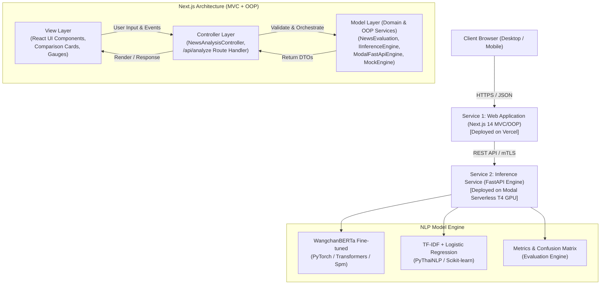

# 🏛️ Architecture & Services Design Document (Task 2)

**Project:** Thai Health Fake-News Detector  
**Course:** 1323404 Natural Language Processing (PIM CAI)  
**Authors:** Team of 6 (P1-P6) • Lead Architect: P5 (Full Stack Engineer)

---

## 1. การวิเคราะห์จำนวน Services (Services Breakdown)

เพื่อให้รองรับสถาปัตยกรรม **MVC (Model-View-Controller)** ร่วมกับกระบวนทัศน์ **OOP (Object-Oriented Programming)** และเปลี่ยนผ่านจาก Gradio ดั้งเดิมไปสู่ Web Application ระดับโปรดักชัน ระบบถูกออกแบบออกเป็น **2 Services หลัก** ในรูปแบบ Monorepo:



### สรุปหน้าที่ของ 2 Services:
1. **Service 1 — Web Application (Next.js MVC + OOP):**
   - **เทคโนโลยี:** Next.js 14 (App Router), TypeScript, Tailwind CSS, Lucide Icons.
   - **หน้าที่:** ให้บริการส่วนติดต่อผู้ใช้ (UI), ควบคุมการตรวจสอบความถูกต้องของข้อมูลตามกฎธุรกิจ (Validation), จัดการการสลับและเปรียบเทียบโมเดลคู่ (Dual-Model Toggle/Comparison), แสดงผลคำเตือนทางการแพทย์ (Medical Disclaimer), และรายงานผลตัวชี้วัด (Metrics).
   - **การ Deploy:** แพลตฟอร์ม **Vercel** แบบ Serverless Edge/Node.js.

2. **Service 2 — NLP Inference Service (FastAPI on Modal):**
   - **เทคโนโลยี:** Python 3.11, FastAPI, PyTorch, Hugging Face Transformers, PyThaiNLP, Scikit-learn, Modal.
   - **หน้าที่:** โหลดและรันโมเดลภาษาไทย Transformer `airesearch/wangchanberta-base-att-spm-uncased` ที่ผ่านการ Fine-tune ด้วยชุดข้อมูล LimeSoda และรันโมเดล Baseline (TF-IDF + Logistic Regression).
   - **การ Deploy:** แพลตฟอร์ม **Modal (modal.com)** รันแบบ Serverless Container พร้อม GPU Acceleration (T4) รองรับการขยายตัวอัตโนมัติ (Autoscaling) และ Scale-to-zero เพื่อประหยัดทรัพยากร.

---

## 2. โครงสร้าง MVC ร่วมกับ OOP ใน Next.js

การเปลี่ยนจาก Gradio เป็น Next.js ถูกจัดหมวดหมู่อย่างเป็นระเบียบตามหลัก **Clean Architecture & SOLID Principles**:

### 🎯 2.1 Model Layer (OOP Domain & Service Abstractions)
- **`News_Evaluation.ts` (Domain Model Class):** ทำหน้าที่ Encapsulation กฎทางธุรกิจในการตรวจสอบข้อความข่าว (Data Integrity):
  - ตรวจสอบความยาวตัวอักษร (Min 5, Max 2,000)
  - ตรวจสอบช่วงรหัสอักขระภาษาไทย Unicode (`[\u0E00-\u0E7F]`)
  - คลีนข้อความและตัดช่องว่างซ้ำซ้อน (Sanitization)
- **`I_Inference_Engine.ts` (Service Interface):** สร้าง Abstraction สำหรับบริการถอดรหัสโมเดล:
  - `predict(text, modelType): Promise<PredictionResultDTO>`
  - `compare(text): Promise<ModelComparisonDTO>`
  - `checkHealth(): Promise<boolean>`
- **`Modal_Fast_Api_Inference_Engine.ts` (Concrete Class):** จัดการการสื่อสารผ่าน HTTP Client ไปยัง Modal Backend พร้อมระบบ AbortSignal Timeout และ Error Mapping.
- **`Mock_Inference_Engine.ts` (Concrete Class):** จำลองผลการทำนายด้วยหลัก Heuristic ภาษาไทย เพื่อรองรับการทำงานแบบ Zero-dependency และ Fallback อัตโนมัติเมื่อบริการระยะไกลขัดข้อง.
- **`Inference_Service_Factory.ts` (Factory Pattern):** คัดเลือก Engine ที่เหมาะสมโดยอิงตาม Environment Variables.

### 🎮 2.2 Controller Layer (Request Handlers)
- **`News_Analysis_Controller.ts` (OOP Controller Class):**
  - รับ Request จาก HTTP Layer
  - สร้าง Instance ของ `NewsEvaluation` เพื่อตรวจสอบ
  - สั่งงาน `IInferenceEngine` เพื่อทำนายผลเดี่ยวหรือเปรียบเทียบผลคู่
  - จัดรูปแบบ HTTP Response Code (200 OK, 400 Bad Request, 502 Bad Gateway) และ DTO Format.
- **`Web/Src/app/api/analyze/route.ts` & `Web/Src/app/api/health/route.ts`:**
  - Route Handlers ของ Next.js App Router ทำหน้าที่เป็นทางผ่านของ Network Protocols ส่งต่อให้ Controller.

### 🖼️ 2.3 View Layer (Presentation Components)
- **`page.tsx`:** หน้าควบคุมหลักรวบรวม State และควบคุมการไหลของข้อมูล.
- **`Nav_Bar.tsx`:** แถบนำทางแสดงข้อมูลรายวิชา 1323404, สถาบัน PIM, และลิงก์ GitHub.
- **`Sample_News_Presets.tsx`:** ชุดข้อความตัวอย่าง 4 หมวดหมู่ (ข่าวปลอม/ข่าวจริง) ให้ทดสอบใน 1 คลิกตามเกณฑ์ TOR.
- **`Model_Comparison_Card.tsx`:** กล่องเปรียบเทียบผลลัพธ์ของ WangchanBERTa คู่กับ Baseline แบบ Side-by-side แสดง Confidence Bar และ Agreement Status.
- **`Disclaimer_Banner.tsx`:** กล่องข้อความเตือนความรับผิดชอบทางการแพทย์.
- **`Metrics_Summary_Modal.tsx`:** Modal แสดงตาราง Accuracy, F1-macro, F1-fake, Precision, Recall, และผลการวิเคราะห์ Error Analysis.

---

## 3. สัญญา API (API Specification & Contracts)

### `POST /api/analyze` (Next.js BFF) / `POST /predict` (Modal FastAPI)
#### Request:
```json
{
  "text": "ดื่มน้ำมะนาวผสมโซดาทุกเช้าช่วยรักษามะเร็งระยะสุดท้ายให้หายขาดได้ 100%",
  "model_type": "both"
}
```

#### Response:
```json
{
  "success": true,
  "data": {
    "wangchanberta": {
      "label": "fake",
      "confidence": 0.945,
      "model": "wangchanberta_finetuned",
      "probabilities": { "fact": 0.055, "fake": 0.945 },
      "latency_ms": 68
    },
    "baseline": {
      "label": "fake",
      "confidence": 0.781,
      "model": "tfidf_logreg_baseline",
      "probabilities": { "fact": 0.219, "fake": 0.781 },
      "latency_ms": 14
    },
    "agreement": true,
    "latency_ms": 82
  }
}
```
